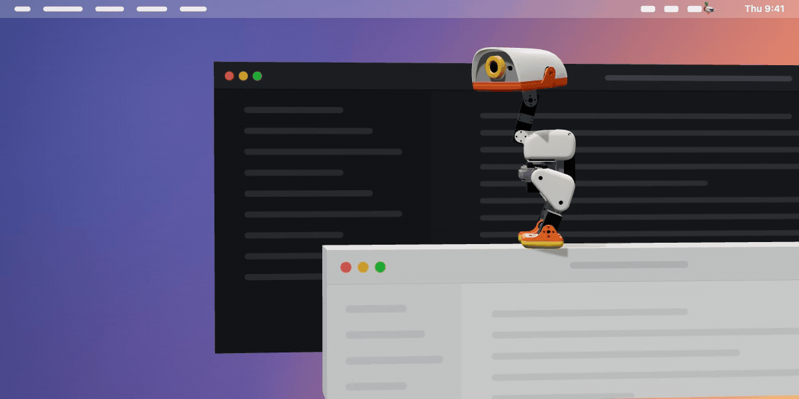
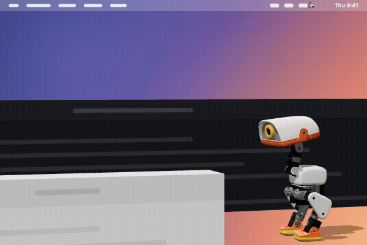
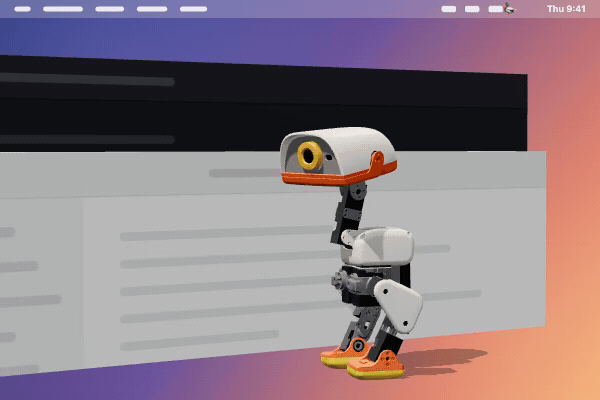
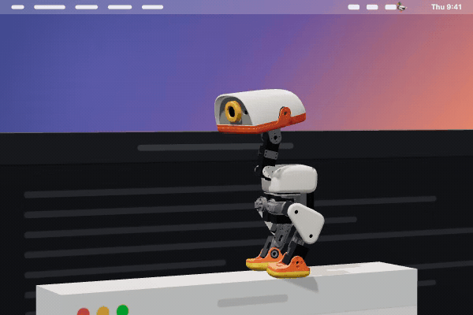
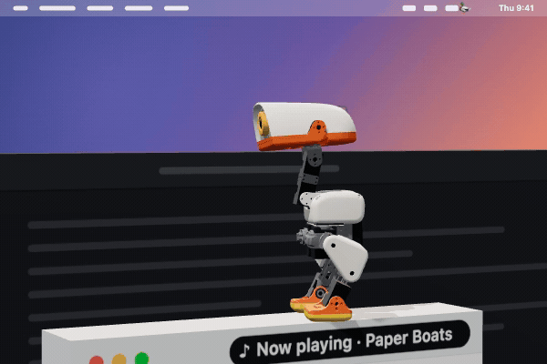
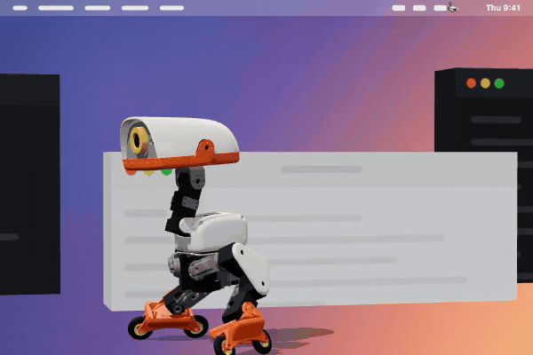
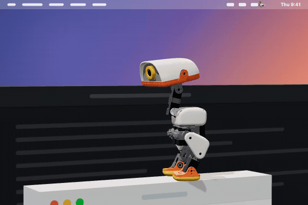

<p align="center">
  
</p>

<h1 align="center">Digital Duck</h1>

<p align="center">
  <em>A robot duck that lives on your Mac.</em>
</p>

<p align="center">
  <a href="https://github.com/gurmundi7/digital-duck/releases/latest"><b>Download for Mac</b></a> ·
  <a href="https://gurmundi7.github.io/digital-duck/">Website</a> ·
  <a href="#how-it-works">How it works</a> ·
  <a href="#privacy">Privacy</a> ·
  <a href="CONTRIBUTING.md">Contributing</a>
</p>

<p align="center">
  <a href="https://github.com/gurmundi7/digital-duck/releases/latest"></a>
  
  <a href="LICENSE"></a>
  <a href="https://github.com/gurmundi7/digital-duck/actions/workflows/ci.yml"></a>
</p>

<p align="center"><sub>An unofficial desktop pet inspired by Pollen's Microduck. Not affiliated with or endorsed by Pollen Robotics or Hugging Face.</sub></p>

---

**A 25 cm robot duck walks along the bottom of your screen.** It climbs your windows, falls over and gets back up, and talks back. Free and open source.

It is [Pollen Robotics](https://www.pollen-robotics.com/)' Microduck in simulation: their MuJoCo model and their trained walking policies, from the open source [Microduck simulator](https://huggingface.co/spaces/pollen-robotics/microduck-simulator) by Pollen Robotics and Hugging Face. Every step is a trained robot policy driving physics, not an animation.

## It does things

<table>
<tr>
<td width="50%"></td>
<td width="50%"></td>
</tr>
<tr>
<td><b>It lives on your desktop.</b> The top of every window is a ledge it can hop onto. Clicks go straight through to your apps.</td>
<td><b>It gets back up.</b> Pick it up and drop it. It finds its feet on its own, like the real robot.</td>
</tr>
<tr>
<td width="50%"></td>
<td width="50%"></td>
</tr>
<tr>
<td><b>It knows you're on a call.</b> Headphones on, music paused, not a word until you hang up.</td>
<td><b>It plays with your music.</b> Dances along, and "next song", "pause", "what's playing?" just work.</td>
</tr>
<tr>
<td width="50%"></td>
<td width="50%"></td>
</tr>
<tr>
<td><b>It skates.</b> "Put on your skates" and it swaps legs for wheels.</td>
<td><b>Pick your duck.</b> Classic, charcoal, purple or blue, the four printed robots.</td>
</tr>
</table>

It also talks back through Claude, keeps your Mac awake when you ask, naps, sulks when ignored, likes being petted and chases a beach ball.

## Install

Download the `.dmg` from [Releases](https://github.com/gurmundi7/digital-duck/releases), drag Digital Duck to Applications, and open it. Apple Silicon and Intel builds are both there.

A 🦆 appears in the menu bar. That is the whole setup.

## Everything it does

- **Walks your desktop.** It wanders the bottom of the screen, looks at your cursor when you come near, and ignores the mouse everywhere else, so clicks go through to your apps.
- **Climbs your windows.** The top edge of each window is a ledge. It hops up, walks along it, rides along when you drag the window, and falls when you close it. "Jump up" and "get down" work in chat.
- **Falls and gets up.** Pick it up and drop it. It tumbles and stands back up on its own, the way the robot does.
- **Talks.** Click it to chat. It answers in a speech bubble and out loud, in character, and does what you ask: sit, roll, peck, dance, come here, put on roller skates, play ball, "nap for 5 minutes". It says at most two sentences out loud; the bubble shows the rest.
- **Has moods.** It gets tired and naps, gets bored and asks for attention, sulks if ignored, and likes being petted (stroke its head with the mouse). It dances when music plays, with a music note floating up from its head now and then.
- **Knows when you're on a call.** A call app in front (Zoom, Meet, FaceTime, Teams, Webex), or another app using the microphone, which calls do even when you are muted. The duck puts on headphones, pauses your music, walks to the edge and stays quiet until the call ends. Its own talk key does not count.
- **Controls your music.** "Pause the music", "next song", "skip this ad", "what's playing?", "volume to 30", or the keys Control+Option+Space, Left, Right, Up and Down. Works with whatever the Mac shows as Now Playing: YouTube Music in a browser, Spotify, Music. Needs `brew install media-control`; volume works without it. It pauses the music while you talk to it and plays it again after its answer.
- **Keeps your Mac awake.** Menu → Keep the Mac awake, or "keep the screen on for 2 hours", "let it sleep". It ends when you quit, and a closed lid still sleeps the Mac.
- **Helps a bit.** "Remind me at 3 to call Sam", "in 20 minutes", "focus for 45 minutes". Reminders stay on your Mac.
- **Does things on your Mac, if you let it.** Opens apps and links, looks things up on the web, or with full access runs anything Claude Code can. See [What the duck can do](#what-the-duck-can-do).
- **Four colours.** Classic, charcoal, purple and blue, the four printed robots.
- **Sleeps.** Left alone it sits, then sleeps with the physics paused and near zero CPU.

Right-click the duck, or click 🦆 in the menu bar, for everything else. **Settings…** (⌘,) has every option in one window.

## Chat

Chat needs a Claude brain. Either works:

- **Claude Code.** If the `claude` CLI is installed and logged in, the duck uses it. Nothing to set up. Replies use your Claude account.
- **An Anthropic API key.** Without the CLI, open Settings → Anthropic API key… and paste a key from [console.anthropic.com](https://console.anthropic.com). It is stored in your login Keychain, never in a file.

Without either, the duck still walks, climbs and plays. It just can't talk back.

Settings → Model picks Haiku (quickest), Sonnet or Opus.

## What the duck can do

A new duck can only talk. Settings → **What the duck can do** has four levels (they need Claude Code; the API key brain only chats):

1. **Chat only.** The default. Runs nothing on your Mac.
2. **Open apps, files and links.** "Open Safari", "open google.com", "open my Downloads". It can launch things but cannot change or delete anything.
3. **Look things up.** Opening, plus web search and reading web pages, for news, weather and facts.
4. **Full access.** Anything Claude Code can do: run commands and scripts, control apps with AppleScript, change files, with no confirmation. Pick this only if you trust everything you say to it, and everything it reads, since a web page or email it reads could try to steer it.

Advanced: flags in `extraArgs` in the config go to the `claude` CLI as they are.

## Off until you turn them on

Each of these is a switch in Settings:

- **Voice input.** Press `Alt+D` and talk. Needs `brew install whisper.cpp` and a speech model in `models/` inside the config folder (`ggml-base.en.bin` from [whisper.cpp](https://huggingface.co/ggerganov/whisper.cpp)). Transcribed on your Mac.
- **Meeting reminders.** Reads your calendar and walks over a few minutes before a meeting.
- **Nudges.** Meeting reminders, stretch breaks, and lines another tool appends to a JSONL file (pick the file in Settings; one `{"message", "source"}` object per line).
- **Pull request watch.** Uses your `gh` CLI to tell you when checks go red or green, or a review lands.
- **Morning briefing and end-of-day recap.**
- **Connectors and MCP servers.** Lets Claude Code use whatever your Claude account has linked (Calendar, Gmail, Slack, Jira and so on) and any servers under `mcpServers` in the config, so the duck can answer from them. Needs Claude Code.

Everything is saved to `~/Library/Application Support/Digital Duck/config.json`. **Edit raw config…** at the bottom of Settings opens it.

## Privacy

What it reads, all on your Mac:

- The position and app name of your on-screen windows, to find ledges. No window titles or contents.
- How long you have been idle and whether the screen is locked, to greet you and pace itself.
- Your first name from your macOS account, to call you by it. Change it under Settings → Your name.
- What is playing, so it can dance. With `media-control` installed: the title, artist and play state of whatever the Mac shows as Now Playing. Without it: whether Music or Spotify is playing, and macOS asks first.
- Whether any app is using a microphone, to know you are on a call. Only in use or not, never the sound, so macOS does not ask.
- Your calendar, only with meeting reminders on. macOS asks first.
- Your open pull requests through `gh`, only with pull request watch on.
- The microphone, only with voice input on, only while you hold the talk key. Audio is transcribed locally and not kept.

What it sends:

- **Chat** goes to Anthropic, through your Claude Code CLI or your API key: what you type or say, a short context line (date, time, how the duck feels, whether you are on a call), its character description, and its notebook of things you asked it to remember. Nothing else.
- **Look things up and Full access** let it search the web through Claude Code, and with Full access, read anything on your Mac it decides it needs to answer you.
- **Connectors**, only with that switch on: Claude Code can read whatever your linked connectors can reach, and the morning briefing asks it about your mail and meetings.

No analytics, no telemetry, no accounts. Its notebook, reminders and chat history stay in the config folder. So does `app.log`, a log of what the app did, kept under about 4 MB. It can include reminder and nudge text, song titles and app names, and never leaves your Mac.

## How it works

A see-through Electron window covers the screen. Inside, Pollen's MuJoCo model runs in WebAssembly and their trained policies run through ONNX Runtime, 50 times a second, drawn with three.js. A small Swift helper lists your windows, and the top edge of each becomes a ledge in the physics. Chat goes to Claude, and macOS `say` gives it a voice.

## Build from source

Needs Node 20+, macOS and Xcode command line tools.

```
git clone https://github.com/gurmundi7/digital-duck
cd digital-duck
npm install
npm start
```

`npm test` runs the tests. `npm run dist` builds the `.dmg` files into `release/`. Signing and notarizing use the Apple Developer ID in your Keychain and a `notarytool` profile set in `APPLE_KEYCHAIN_PROFILE`.

Debugging: `kill -USR2 <pid>` writes `snap.png` (the duck's own render) to the config folder and logs its pose. `kill -USR1 <pid>` runs `debug.js` from that folder inside the renderer (`duck.sim`, `duck.behaviour`, `duck.bubble` are global).

```
electron/   window, menu, brain, speech, helpers (Swift)
renderer/   physics and policy loop, behaviour, bubble, audio
sim/        Pollen's simulator source and assets, unchanged (Apache 2.0)
```

## Roadmap

- **Windows build (fast follow).** The physics, policies, rendering and chat already run anywhere Electron does. These parts are Mac only today and need a Windows version:
  - `electron/winlist.swift`, the window list that becomes ledges (CoreGraphics)
  - `electron/agenda.swift`, meeting reminders (EventKit)
  - `electron/micwatch.swift`, whether a microphone is in use, for call detection (CoreAudio)
  - spoken replies through macOS `say` voices
  - start at login through a LaunchAgent (checkouts) or a macOS login item
  - voice input through `brew install whisper.cpp`
  - music detection and control through AppleScript and `media-control`, and the Mac volume
- **More brains.** Today the duck talks through Claude Code or an Anthropic API key. Next: a local model through Ollama, OpenAI's Codex CLI, OpenRouter, and any OpenAI-compatible endpoint, each as a pick in Settings → Brain. The app-running levels stay tied to an agent CLI that can take tool permissions.

## Contributing

Bug reports, "can it do X?" ideas and pull requests are welcome. See [CONTRIBUTING.md](CONTRIBUTING.md).

## Credits and license

The robot, its model, policies, meshes, voices and the simulator are by [Pollen Robotics](https://www.pollen-robotics.com/) and [Hugging Face](https://huggingface.co/spaces/pollen-robotics/microduck-simulator), under Apache 2.0 (`sim/LICENSE-pollen-simulator`). The model and the walking policies come from [pollen-robotics/microduck](https://github.com/pollen-robotics/microduck) and [pollen-robotics/microduck_rl](https://github.com/pollen-robotics/microduck_rl). Physics by [MuJoCo](https://github.com/google-deepmind/mujoco), rendering by [three.js](https://threejs.org/), policies run on [ONNX Runtime Web](https://onnxruntime.ai/), all inside [Electron](https://www.electronjs.org/). Microduck is Pollen Robotics' robot. Digital Duck is not affiliated with or endorsed by Pollen Robotics or Hugging Face. If you like the duck, get the real one.

Digital Duck is Apache 2.0. See `LICENSE` and `NOTICE`.
